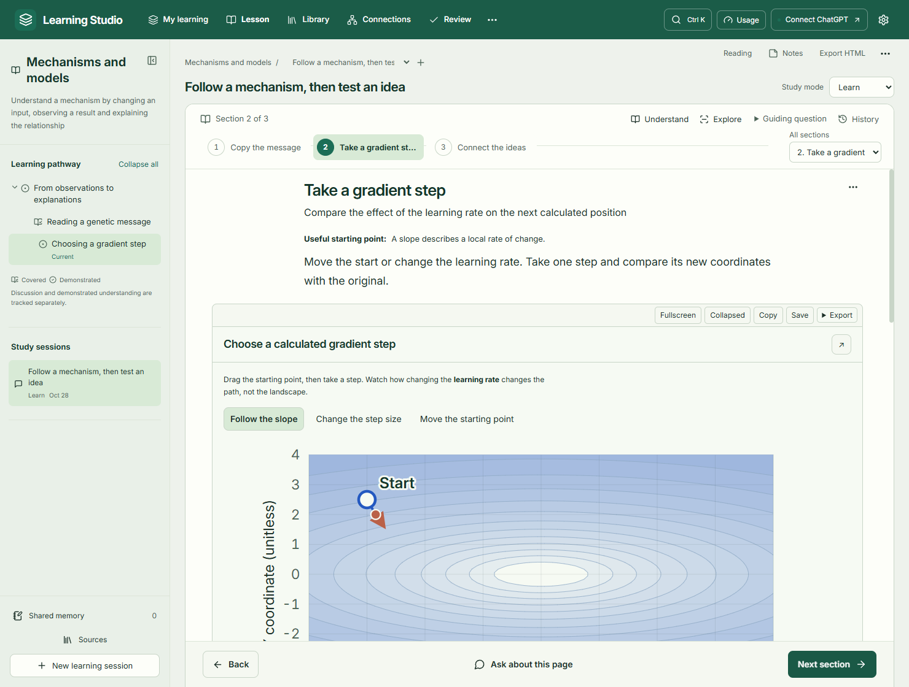
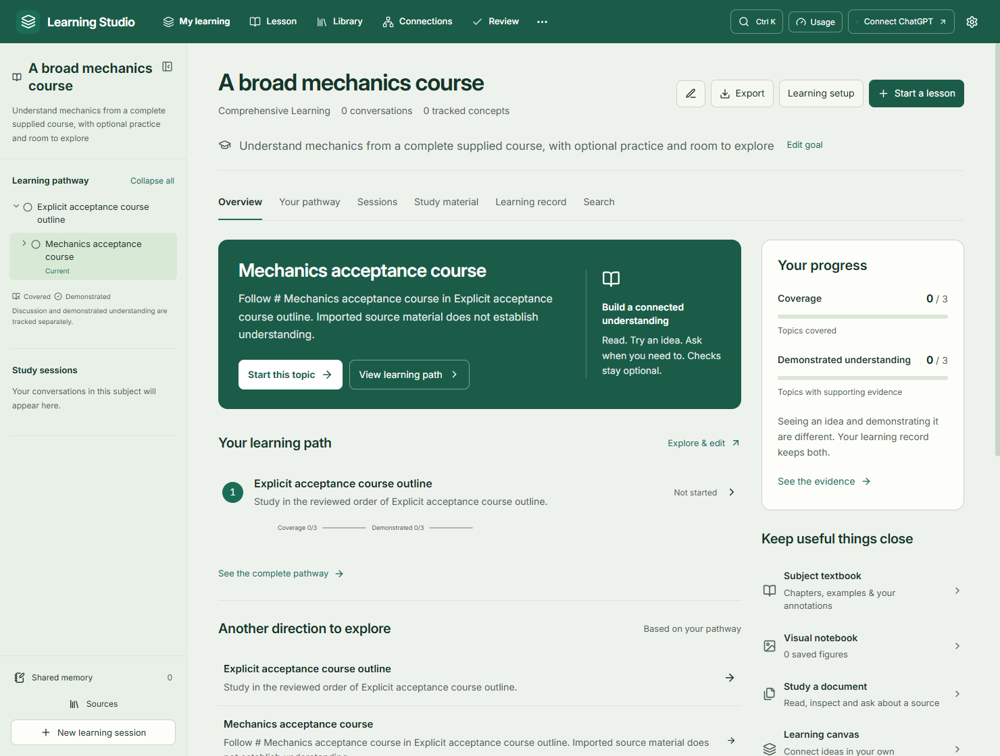

# Learning Studio

**Learn a subject, follow a curriculum, and work through ideas with interactive experiments.**

Learning Studio is a Windows desktop application that combines an AI tutor with a persistent learning workspace. Build a pathway for a broad subject, bring a university course outline, or study an authorized textbook. Explanations, equations, figures, notes and optional practice stay connected to the material you are learning.

Built using **OpenAI Codex**.



## What you can do

- **Study by subject.** Keep related lessons, conversations, goals, resources and learning evidence in one workspace. Continue across chats without sending the model your entire history.
- **Follow your own material.** Import PDF, Markdown or text, paste a syllabus, or use a readable public source. Review the detected chapters and topics before adopting a pathway.
- **Work through a lesson.** Read one section at a time, use Back/Next, and open the tutor when you want help. The full conversation record remains available.
- **Learn through interaction.** Change parameters in calculated plots and simulations, inspect scientific SVG diagrams, and explore real molecular structures. Figures appear inline and retain their state.
- **Choose how to learn.** Switch between Learn, Explore, Deep Dive, Practice and Review. Setup and assessments are optional. Coverage is tracked separately from demonstrated understanding.
- **Connect your knowledge.** Explore concepts, typed relationships, evidence, backlinks and sources in a searchable knowledge graph.
- **Keep useful work.** Save highlights, notes, references and visualizations; build an editable subject textbook or arrange material on a learning canvas.
- **Study offline exports.** Export selected material or a subject as portable HTML/ZIP with supported mathematics and interactions. An account is not needed to open an exported textbook.
- **Make it comfortable.** Use light, dark or system appearance, edit theme colors and typography, and adjust reading size independently of application zoom.

## AI connections

The application supports **Sign in with ChatGPT for eligible accounts** through the documented integration. This connection does not require a separately billed API key. Available models and reasoning options depend on the account and are discovered rather than assumed.

You can also explicitly configure an existing Ollama server or an OpenAI-compatible provider. Learning Studio does not install a local model. Other providers may have their own access, privacy and billing requirements. The app never silently switches providers or paid billing.

Background AI use requires consent. Remote response time and limits depend on the provider. The supported ChatGPT integration does not expose a reliable remaining-plan-quota API, so Learning Studio does not invent a remaining percentage. Scientific rendering runs locally; no paid image-generation service is required.

## Install on Windows

Download **Learning Studio Setup 2.4.0.exe** from [Releases](https://github.com/aahil1412/LearningStudio/releases), once published, and run it. The installer includes Electron and its runtime; Node.js is needed only for development. This local release is unsigned.

**The installer and source repository contain no saved chats, credentials or personal learning library.** A new installation starts empty. An upgrade on a computer that already has Learning Studio normally retains that computer's local data. See [fresh starts and backups](docs/DATA_AND_PRIVACY.md) if you want an empty library.



## Run from source

Use native Windows PowerShell with Node.js 24 LTS and npm:

```powershell
git clone https://github.com/aahil1412/LearningStudio.git
Set-Location .\LearningStudio
npm ci
npm run build
npm start
```

For development:

```powershell
npm run dev:desktop
```

`npm run dev` provides a limited renderer preview. Authentication, SQLite, document import and desktop services require the Electron application. If changing Node/Electron causes a native SQLite binding error, run `npx electron-builder install-app-deps`.

## Build and check

```powershell
npm run typecheck
npm run lint
npm test
npm run build
npm run test:e2e
npm run package -- --config.directories.output=release/2.4.0
```

Network integration tests are optional and use public scientific services:

```powershell
$env:STUDIO_NETWORK_TESTS = '1'
npm test
npm run test:e2e
Remove-Item Env:\STUDIO_NETWORK_TESTS
```

The recorded 2.4 verification has **443 passing unit/integration checks**, **121 unique workflows with passing latest results**, and **6/6 redesigned workflows passing against the packaged executable**. Reruns are not additional workflows. See [verification scope and limitations](docs/VERIFICATION.md).

## Project structure

| Path        | Purpose                                                                         |
| ----------- | ------------------------------------------------------------------------------- |
| `src/`      | React interface, lesson presentation, themes and validated scientific renderers |
| `electron/` | Desktop lifecycle, secure connections, SQLite, retrieval, jobs and exports      |
| `tests/`    | Unit, integration and actual Electron/browser acceptance tests                  |
| `assets/`   | Application assets, openly licensed fonts and OCR resources                     |
| `scripts/`  | Development, build, packaging and packaged verification tools                   |
| `docs/`     | Current guides, architecture, verification summary and curated screenshots      |

Build output, dependencies, credentials, private libraries and test artifacts are excluded from Git. Installers are distributed through GitHub Releases.

## Documentation

- [User guide](docs/USER_GUIDE.md)
- [Curricula and textbooks](docs/SOURCE_STUDY.md)
- [Data, privacy and fresh starts](docs/DATA_AND_PRIVACY.md)
- [Architecture](docs/ARCHITECTURE.md)
- [Verification and known limits](docs/VERIFICATION.md)
- [Third-party notices](docs/THIRD_PARTY_NOTICES.md)
- [Contributing](CONTRIBUTING.md)

Learning Studio is independently developed and is not an official OpenAI product. AI-generated explanations can be incorrect; source links, calculations and evidence remain inspectable. The project's original code is licensed under [MIT](LICENSE). Dependencies, fonts, retrieved figures and scientific resources retain their own licenses and attribution requirements.
